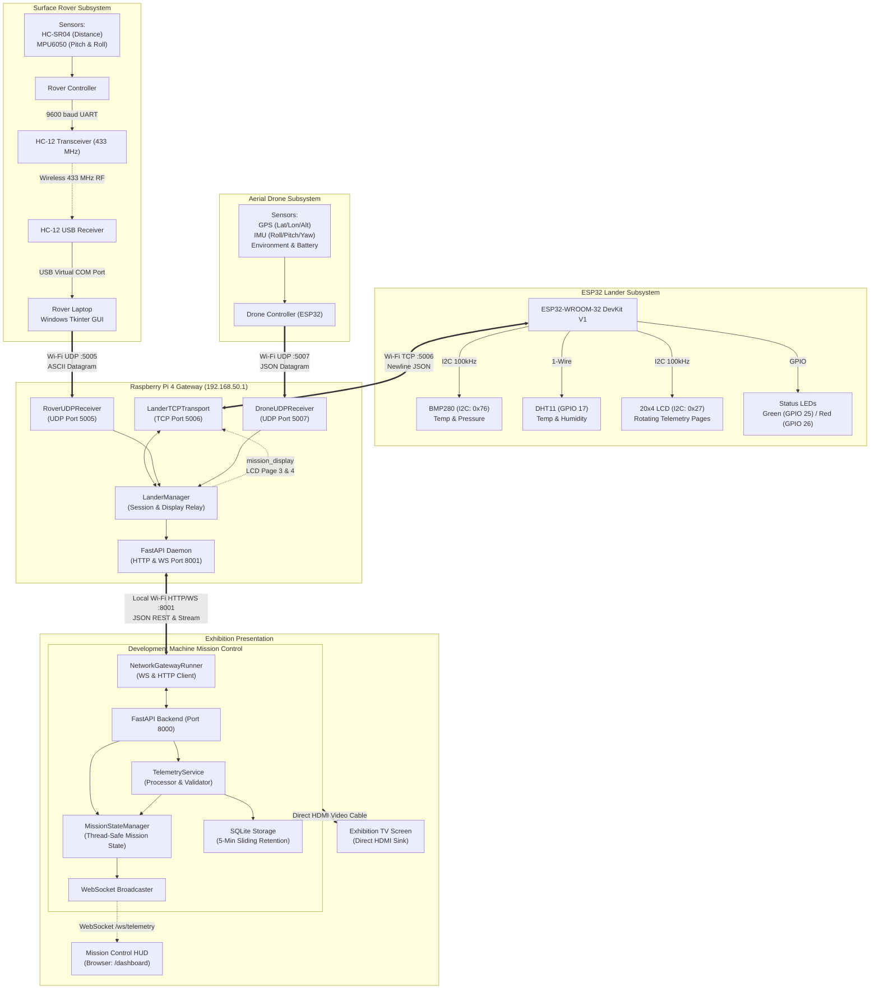
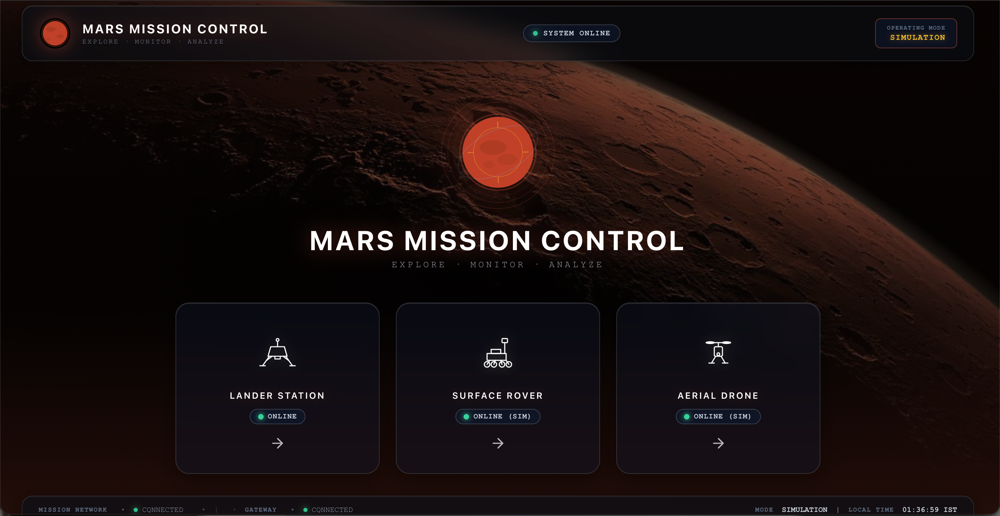
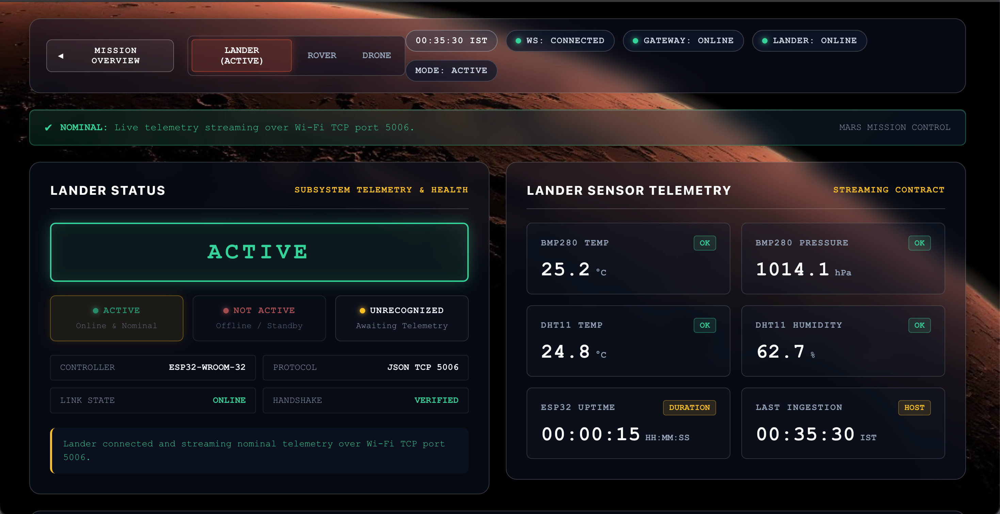
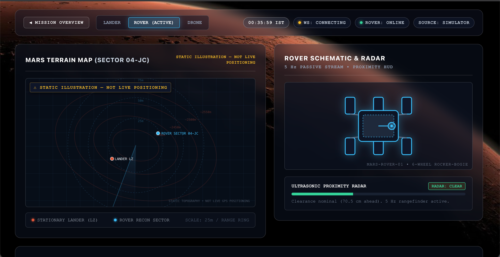
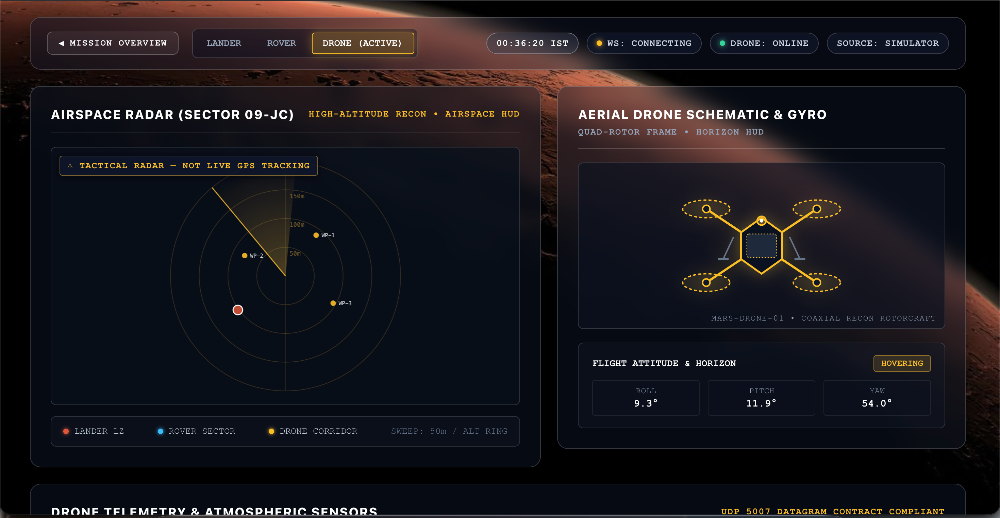
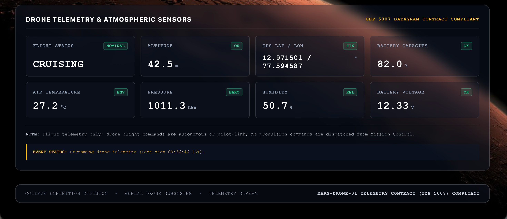

# Mars Mission Control

**A Distributed Embedded Telemetry and Monitoring System**

Mars Mission Control is a local-first mission monitoring system developed for a Mars exploration simulation. It integrates embedded hardware, wireless telemetry, a Raspberry Pi edge gateway, a backend telemetry pipeline, and a real-time dashboard.

The system brings together three independent subsystems:

- **Surface Rover** — Ultrasonic distance and IMU attitude telemetry over HC-12 radio relay
- **Aerial Drone** — GPS, IMU, environmental and battery telemetry over Wi-Fi UDP
- **Mars Lander** — ESP32-based sensor platform with local 20×4 LCD display and status LEDs

The lander acts as a physical monitoring and display unit at the exhibition site, while Mission Control aggregates telemetry from all three subsystems and presents the overall mission state.

---

## System Overview

### Surface Rover
The rover carries an HC-SR04 ultrasonic distance sensor and an MPU6050 IMU. A microcontroller on the rover chassis reads these sensors and transmits ASCII telemetry packets at 9600 baud over an HC-12 433 MHz radio link to a Windows laptop. A custom Tkinter GUI on the laptop parses the serial stream and forwards validated packets via UDP to the Raspberry Pi gateway (port 5005).

**Packet format:** `DIST:145.0,PITCH:12.4,ROLL:-3.2,CMD:F,MODE:M`

### Aerial Drone
An ESP32-based flight controller transmits JSON telemetry datagrams directly to the Pi gateway over Wi-Fi UDP (port 5007). The payload includes GPS position, orientation, environmental readings, and battery state. Sequence numbers with RFC 1982 rollover handling provide duplicate and out-of-order detection.

### Mars Lander
An ESP32-WROOM-32 DevKit V1 hosts a BMP280 (temperature/pressure), DHT11 (temperature/humidity), a 20×4 I2C character LCD, and two status LEDs. The ESP32 connects to the Pi's private Wi-Fi access point and streams newline-delimited JSON telemetry over TCP (port 5006) at ~1 Hz in ACTIVE mode. Commands (`GET_STATUS`, `SET_ACTIVE`, `SET_STANDBY`) share the same TCP connection. The lander LCD rotates through five pages including remote rover and drone telemetry forwarded by the Pi via `mission_display` messages.

### Mission Control (Raspberry Pi Gateway + Backend + Dashboard)
| Component | Role | Technology |
|---|---|---|
| **Raspberry Pi 4 Gateway** | Edge aggregator for all three telemetry streams | Python, FastAPI, asyncio TCP/UDP servers |
| **Development Machine Backend** | Mission state, SQLite persistence, API, WebSocket broadcast | Python, FastAPI, WebSockets, SQLite |
| **Dashboard** | Real-time HUD for exhibition display | Vanilla ES6, CSS custom properties, WebSocket + polling fallback |

The Pi gateway exposes REST endpoints and a WebSocket stream on port 8001. The backend connects to the gateway over HTTP/WebSocket, normalizes telemetry, persists a 5-minute sliding window to SQLite, and broadcasts live updates to the dashboard. The dashboard receives updates via WebSocket (primary) with a 2-second HTTP polling fallback.

---

## System Architecture



---

## Communication Architecture

| Subsystem | Communication | Destination | Port | Format |
|---|---|---|---|---|
| Lander | TCP (Wi-Fi) | Raspberry Pi Gateway | 5006 | Newline-delimited JSON |
| Rover Laptop | UDP (Wi-Fi) | Raspberry Pi Gateway | 5005 | ASCII key:value pairs |
| Drone | UDP (Wi-Fi) | Raspberry Pi Gateway | 5007 | JSON with sequence numbers |
| Pi Gateway → Backend | HTTP + WebSocket | Development Machine | 8001 | JSON REST & Stream |
| Backend → Dashboard | HTTP + WebSocket | Browser | 8000 | JSON REST & Stream |

**Why multiple mechanisms?** Each subsystem has different physical constraints: the lander has Wi-Fi and runs a persistent TCP stream; the rover communicates over 433 MHz radio to a laptop which forwards via UDP; the drone uses Wi-Fi UDP directly. The Pi gateway normalizes these into a unified HTTP/WebSocket API for the backend.

---

## Hardware

### Lander (Verified)
- **MCU:** ESP32-WROOM-32 DevKit V1
- **Sensors:** BMP280 (I2C, 0x76), DHT11 (GPIO 17)
- **Display:** 20×4 I2C LCD (PCF8574 backpack, 0x27)
- **Indicators:** Green LED (GPIO 25, ACTIVE mode), Red LED (GPIO 26, sensor error)
- **Radio:** Internal 2.4 GHz Wi-Fi (Station mode)
- **Power:** 5V USB / 3.3V regulator, WS2812B brightness clamped to 60/255

### Rover (Verified Sensors, Chassis MCU External)
- **Distance:** HC-SR04 ultrasonic (2–400 cm, ±3 mm)
- **Orientation:** MPU6050 IMU (I2C, 0x68, ±2g/±250°/s)
- **Radio:** HC-12 433 MHz module (9600 baud UART, ×2)
- **Laptop:** Windows Tkinter GUI (COM port → UDP forwarder)

### Drone (Telemetry Interface Defined, Flight Controller External)
- **Controller:** ESP32-based (custom or commercial)
- **Sensors:** GPS (UART/I2C), IMU (MPU6050/ICM20602), Environment (BMP280/BME280), Battery (ADC)
- **Radio:** Wi-Fi Station → UDP 5007
- **Status:** Transport and JSON schema implemented; physical flight controller not in this repository

### Gateway (Verified)
- **Platform:** Raspberry Pi 4 Model B (2/4/8 GB)
- **OS:** Raspberry Pi OS (64-bit) Lite
- **Network:** `wlan0` as AP (192.168.50.1), `eth0`/`wlan1` uplink to development machine
- **Services:** `hostapd`, `dnsmasq`, gateway FastAPI daemon (systemd)

[Detailed hardware documentation →](docs/hardware/hardware-overview.md)

---

## Software Architecture

### ESP32 Firmware (`lander/lander.ino`)
- FreeRTOS task structure: sensor polling (core 0), LCD rendering (core 1), Wi-Fi/TCP (core 0), LED control (core 1)
- Non-blocking LCD page rotation (5 pages, 2.5–5 s intervals)
- Newline-delimited JSON telemetry with sensor health flags
- Command parser for `GET_STATUS`, `SET_ACTIVE`, `SET_STANDBY`
- Automatic Wi-Fi reconnection with 1 s retry interval

### Raspberry Pi Gateway (`gateway/`)
| Module | Responsibility |
|---|---|
| `lander_manager.py` | TCP session, command correlation, staleness (3 s STALE / 10 s OFFLINE), `mission_display` forwarding |
| `tcp_transport.py` | Asyncio TCP framing, line buffering, connection lifecycle |
| `rover_udp.py` | ASCII packet parsing, 5-field validation, 2 s OFFLINE timeout |
| `drone_udp.py` | JSON schema validation, RFC 1982 sequence rollover, 10 s OFFLINE timeout |
| `ws_manager.py` | WebSocket connection manager with broadcast and client pruning |
| `routes.py` / `main.py` | FastAPI REST + WS endpoints (`/health`, `/api/*`, `/ws/telemetry`) |

### Backend (`backend/app/`)
| Layer | Components |
|---|---|
| **Runners** | `NetworkGatewayRunner` (WS + HTTP), `RoverRunner`, `DroneRunner`, `GatewaySimulatorRunner`, `RoverSimulatorRunner`, `DroneSimulatorRunner` — all implementing `BaseRunner` |
| **Services** | `TelemetryService` (validation, normalization, SQLite storage, WS broadcast), `MissionStateManager` (aggregated state snapshot), `CommandTracker` (audit log, deduplication), `WebSocketManager` (client connections) |
| **API** | REST endpoints (`/api/mission/*`, `/api/rover/status`, `/api/drone/status`), WebSocket `/ws/telemetry` |
| **Storage** | `SQLiteStorage` with WAL mode, 5-minute sliding retention, session reset |

### Frontend (`frontend/`)
- Single-page HUD served at `/dashboard`
- ES6 modules: `mission-client.js` (WS + polling), `lander-view.js`, `rover-view.js`, `drone-view.js`, `formatters.js`
- CSS custom properties for theming, dark space aesthetic with subsystem color coding (Lander: Mars red, Rover: Cyan, Drone: Amber)
- Graceful WebSocket reconnection with exponential backoff, polling fallback on disconnect

---

## Dashboard Showcase

> **Note:** Screenshots captured from simulation mode. Telemetry values are synthetic and do not represent physical hardware measurements.

### Main Mission Control Dashboard

*The primary HUD (landing screen) showing the three subsystem cards (Lander Station, Surface Rover, Aerial Drone) with live connection status indicators and navigation to detailed views. Captured in Simulation Mode.*

### Lander Status View

*Lander dashboard showing environmental telemetry (BMP280 temperature/pressure, DHT11 temperature/humidity), subsystem state (ACTIVE/NOT ACTIVE/UNRECOGNIZED), command audit log, telemetry history, mission event log, and diagnostic controls. Captured in Simulation Mode.*

### Rover Telemetry View

*Surface Rover dashboard with Mars terrain map (static illustration), rover schematic with rocker-bogie suspension, ultrasonic proximity radar, and telemetry grid showing obstacle distance, pitch/roll attitude, reported command, drive mode, battery voltage, and capacity (unmapped). Captured in Simulation Mode.*

### Drone Telemetry View

*Aerial Drone dashboard with airspace radar (static illustration), drone schematic with quad-rotor frame, flight attitude & gyro (roll/pitch/yaw), and telemetry grid showing flight status, altitude, GPS coordinates, battery capacity/voltage, air temperature, pressure, and humidity. Captured in Simulation Mode.*

### Drone Telemetry Detail (Scrolled)

*Drone dashboard scrolled to show full telemetry grid: flight status, altitude, GPS coordinates, battery capacity & voltage, air temperature, pressure, and humidity readings. Captured in Simulation Mode.*

---

## Operating Modes

Exactly two modes. No hybrid mode exists.

### Simulation Mode (`sim`)
```bash
python run.py sim
```
Runs entirely in-process on the development machine. All three subsystems use deterministic in-memory simulators:
- `GatewaySimulator` — synthetic BMP280/DHT11 readings at 1 Hz
- `RoverSimulator` — cyclic terrain profile with distance, pitch, roll variations
- `DroneSimulator` — flight phase progression (STANDBY → TAKEOFF → CRUISING → HOVERING → LANDING)

No physical hardware, no Raspberry Pi, no network dependencies required.

### Network Mode (`network`)
```bash
python run.py network
```
Connects to physical hardware via the Raspberry Pi gateway:
- Backend WebSocket to Pi Gateway (`ws://192.168.50.1:8001/ws/telemetry`)
- HTTP polling for rover/drone status (`/api/rover/status`, `/api/drone/status`)
- Requires Pi gateway running, ESP32 lander on Mission-Control Wi-Fi, rover laptop forwarding UDP, drone ESP32 transmitting UDP

Environment variables control each subsystem independently:
```bash
GATEWAY_MODE=network|simulator
ROVER_MODE=network|simulator
DRONE_MODE=network|simulator
GATEWAY_HTTP_URL=http://192.168.50.1:8001
GATEWAY_WS_URL=ws://192.168.50.1:8001/ws/telemetry
```

---

## Engineering Details

| Area | Implementation |
|---|---|
| **Embedded Firmware** | ESP32 FreeRTOS tasks, I2C sensor drivers, 1-Wire DHT11, LCD I2C, WS2812B animations, Wi-Fi STA + TCP client |
| **I2C Sensor Integration** | BMP280 (0x76) with compensation algorithms, DHT11 bit-banged timing, shared bus with LCD at 100 kHz |
| **TCP Communication** | Persistent ESP32→Pi connection, newline JSON framing, request/response correlation via integer `request_id`, automatic reconnection |
| **UDP Telemetry Receivers** | Asyncio `datagram_received` handlers, strict field validation, staleness monitors, last-valid-state retention |
| **JSON Message Framing** | Line-oriented parsing with 4 KB buffer, partial line handling, bootloader text filtering |
| **Telemetry Validation** | Pydantic models for all schemas, numeric range checks, enum validation, NaN/Infinity rejection |
| **Connection State Tracking** | Independent gateway/device states: CONNECTED/STALE/OFFLINE/NOT_CONNECTED, separate health from connectivity |
| **WebSocket Updates** | Event-driven broadcast to all dashboard clients, `state_snapshot` on connect, per-telemetry messages |
| **Independent Simulators** | Deterministic virtual clock, no `time.sleep`, stepped execution for testing, `IS_SIMULATOR` flag never masquerades as hardware |
| **Gateway Deployment** | `rsync`-based push from development machine, excludes `.env`, databases, firmware, virtual environments, frontend assets |

---

## Engineering Challenges

### 1. Multi-Source Telemetry Unification
**Challenge:** Three subsystems with different physical transports (TCP, UDP via laptop, UDP direct), different formats (JSON, ASCII), different rates (1 Hz, 5 Hz, 2 Hz), and different validation requirements.
**Solution:** The Pi gateway normalizes all three into a common internal representation. Each receiver (`LanderManager`, `RoverUDPReceiver`, `DroneUDPReceiver`) validates its specific protocol, tracks staleness independently, and publishes a unified status object via the gateway's HTTP/WebSocket API. The backend treats all sources uniformly through the runner pattern.

### 2. Remote LCD Updates Over Existing TCP Channel
**Challenge:** The lander's 20×4 LCD must display rover and drone telemetry, but the ESP32 has only one Wi-Fi radio and one TCP connection to the Pi.
**Solution:** The Pi gateway's `LanderManager` multiplexes `mission_display` messages over the existing lander TCP connection. Rover updates at 4 Hz (with 2.5 s heartbeat), drone at 2 Hz. The lander firmware renders these on LCD pages 3 and 4 within its non-blocking page rotation. Rate limiting prevents LCD flooding.

### 3. Device Disconnection and Stale Telemetry
**Challenge:** Wireless links fail. The system must distinguish between a healthy gateway with a disconnected device and an unhealthy gateway.
**Solution:** Dual-layer state tracking. The Pi gateway tracks device connection state independently from gateway process health. The backend tracks gateway WebSocket state separately from device telemetry freshness. Staleness thresholds are protocol-appropriate (lander: 3 s STALE / 10 s OFFLINE; rover: 2 s OFFLINE; drone: 10 s OFFLINE). Offline devices retain last-known readings marked explicitly offline.

### 4. Independent Simulation and Hardware Modes
**Challenge:** Development must work without hardware, but production uses physical devices. Mode switching must be configuration-only, not code changes.
**Solution:** The runner pattern with `BaseRunner` abstraction. Each subsystem (gateway, rover, drone) has a `NetworkRunner` and a `SimulatorRunner`. Mode selection via `GATEWAY_MODE`, `ROVER_MODE`, `DRONE_MODE` environment variables. The same API routes instantiate the appropriate runner at startup. No code paths differ between modes except the runner implementation.

### 5. Debugging Wireless Communication
**Challenge:** Intermittent Wi-Fi drops, HC-12 packet loss, TCP connection resets during ESP32 boot.
**Solution:** Structured logging at every layer. Gateway logs TCP connection events, JSON parse failures, command acknowledgements. Rover receiver logs parsing failures with raw packet hex. Drone receiver logs sequence gaps and rollover events. Backend logs WebSocket reconnection attempts with exponential backoff. All telemetry includes host receipt timestamps for correlation.

---

## Technology Stack

| Layer | Technologies |
|---|---|
| **Firmware** | ESP32, C/C++, Arduino framework, FreeRTOS |
| **Sensors** | BMP280, DHT11, HC-SR04, MPU6050, GPS, IMU |
| **Communication** | TCP, UDP, Wi-Fi (2.4 GHz), HC-12 (433 MHz), JSON, ASCII |
| **Gateway** | Raspberry Pi 4, Python 3.11+, FastAPI, asyncio, uvicorn |
| **Backend** | Python 3.11+, FastAPI, WebSockets, SQLite (WAL), Pydantic |
| **Frontend** | Vanilla ES6, CSS Custom Properties, WebSocket API |
| **Storage** | SQLite with 5-minute sliding window retention |
| **Deployment** | rsync over SSH, systemd service on Pi |

---

## Repository Structure

```
mars-mission-control/
├── Lander/                  # ESP32 firmware
│   └── lander/              # lander.ino, config headers
├── backend/                 # Development machine backend
│   ├── app/
│   │   ├── api/             # REST + WebSocket routes
│   │   ├── communication/   # Runners, simulators, gateway client
│   │   ├── models/          # Telemetry, command, state dataclasses
│   │   ├── services/        # TelemetryService, MissionStateManager, etc.
│   │   └── storage/         # SQLiteStorage
│   ├── tests/               # 69 backend tests
│   └── requirements.txt
├── gateway/                 # Raspberry Pi gateway daemon
│   ├── lander_manager.py    # TCP session + display relay
│   ├── tcp_transport.py     # TCP framing
│   ├── rover_udp.py         # ASCII UDP receiver
│   ├── drone_udp.py         # JSON UDP receiver + RFC 1982
│   ├── ws_manager.py        # WebSocket broadcaster
│   ├── routes.py            # FastAPI routes
│   ├── main.py              # App factory + lifespan
│   ├── tests/               # 43 gateway tests
│   └── requirements.txt
├── frontend/                # Dashboard
│   ├── index.html
│   ├── css/
│   ├── js/
│   └── assets/
├── deploy/
│   └── deploy_gateway.sh    # rsync deployment script
├── docs/                    # Documentation
│   ├── architecture/        # System, software, network, data flow
│   ├── deployment/          # Gateway, local development
│   ├── hardware/            # Lander, rover, drone, wiring
│   ├── protocols/           # TCP, rover UDP, drone UDP, schemas
│   ├── testing/             # Verification results, strategy
│   ├── wiring/              # Schematics
│   ├── DECISIONS.md         # Architectural Decision Records
│   └── portfolio/           # Project description (this file)
├── run.py                   # Unified launcher (sim|network)
├── run_backend.sh           # Convenience wrapper
└── AGENTS.md                # Engineering constraints
```

---

## Getting Started

### Prerequisites
- Python 3.10+
- Git
- Modern browser (Chrome, Edge, Firefox, Safari)

### Development Machine Setup
```bash
# 1. Clone repository
git clone <repository-url>
cd mars-mission-control

# 2. Create virtual environment in backend/
python3 -m venv backend/.venv

# 3. Activate virtual environment
source backend/.venv/bin/activate        # macOS/Linux
# .\backend\.venv\Scripts\Activate.ps1   # Windows PowerShell

# 4. Install dependencies
pip install --upgrade pip
pip install -r backend/requirements.txt
```

### Run in Simulation Mode (No Hardware)
```bash
python run.py sim
# Opens http://localhost:8000/dashboard
```

### Run in Network Mode (With Hardware)
```bash
# 1. Deploy gateway to Raspberry Pi
./deploy/deploy_gateway.sh
ssh pi@192.168.50.1 "sudo systemctl restart mars-gateway.service"

# 2. Connect development machine to Mission-Control Wi-Fi
# 3. Start backend
python run.py network
# Opens http://localhost:8000/dashboard
```

### Raspberry Pi Gateway Deployment
```bash
# On development machine (connected to Mission-Control Wi-Fi)
./deploy/deploy_gateway.sh

# On Pi (or via SSH)
sudo systemctl restart mars-gateway.service

# Verify
curl http://192.168.50.1:8001/health
curl http://192.168.50.1:8001/api/lander/status
```

[Detailed deployment guide →](docs/deployment/gateway-deployment.md)

---

## Documentation

| Document | Description |
|---|---|
| [System Architecture](docs/architecture/system-architecture.md) | Component overview and data flows |
| [Software Architecture](docs/architecture/software-architecture.md) | Code organization, patterns, concurrency |
| [Network Architecture](docs/architecture/network-architecture.md) | Topology, ports, firewall, verification |
| [Data Flow](docs/architecture/data-flow.md) | Detailed telemetry flow diagrams |
| [Hardware Overview](docs/hardware/hardware-overview.md) | All subsystems, pinouts, power budgets |
| [Lander Hardware](docs/hardware/lander.md) | ESP32 pinout, sensors, wiring |
| [Rover Hardware](docs/hardware/rover.md) | Sensors, HC-12, laptop GUI |
| [Drone Hardware](docs/hardware/drone.md) | Expected sensors, telemetry |
| [Wiring](docs/wiring/) | Schematics and connection diagrams |
| [Communication Overview](docs/protocols/communication-overview.md) | Protocol summary table |
| [TCP Protocol](docs/protocols/tcp-protocol.md) | Lander JSON message formats |
| [Rover UDP](docs/protocols/rover-udp.md) | ASCII packet format and validation |
| [Drone UDP](docs/protocols/drone-udp.md) | JSON schema and sequence handling |
| [API Contract](docs/api-contract.md) | Gateway and backend REST/WS endpoints |
| [Gateway Deployment](docs/deployment/gateway-deployment.md) | Pi deployment workflow |
| [Local Development](docs/deployment/local-development.md) | Workstation setup and modes |
| [Testing Strategy](docs/testing/testing-strategy.md) | Test architecture and methodologies |
| [Verification Results](docs/testing/verification-results.md) | 112 test baseline with scope delineation |
| [Architectural Decisions](docs/DECISIONS.md) | ADR index and detailed records |

---

## Testing

| Suite | Tests | Scope |
|---|---|---|
| Backend | 69 | Runners, simulators, telemetry processing, storage, API, WebSocket, firmware contract |
| Gateway | 43 | TCP transport, lander manager, rover/drone UDP receivers, WebSocket, integration |

**Total: 112 tests passing**

```bash
# Run full suite
PYTHONPATH=.:backend:gateway backend/.venv/bin/pytest

# Backend only
PYTHONPATH=.:backend backend/.venv/bin/pytest backend/tests

# Gateway only
PYTHONPATH=.:gateway backend/.venv/bin/pytest gateway/tests
```

**Verification Scope:**
- Automated tests verify software contracts, schemas, state transitions, parser correctness, and async lifecycle
- Physical hardware verification (sensor accuracy, RF reception, LCD I2C address, Wi-Fi antenna performance) is **not** covered by automated tests and requires exhibition-venue validation

---

## Project Status

Mars Mission Control is a completed exhibition implementation with a documented, reproducible software architecture. The system demonstrates:

- Embedded firmware with FreeRTOS task structure and wireless communication
- Edge gateway aggregating three heterogeneous telemetry streams
- Backend with independent simulator/hardware modes, SQLite persistence, WebSocket streaming
- Real-time dashboard with graceful degradation

**Physical hardware notes:** The rover chassis MCU firmware and drone flight controller firmware are not in this repository. Their telemetry interfaces are defined and implemented in the gateway and backend. The lander firmware is complete and included.

---

## License

This project is licensed under the MIT License — see the [LICENSE](LICENSE) file for details.

---

## Credits

Developed as a Mars exploration simulation for exhibition. Engineering, firmware, gateway, backend, and dashboard implementation by the project author.